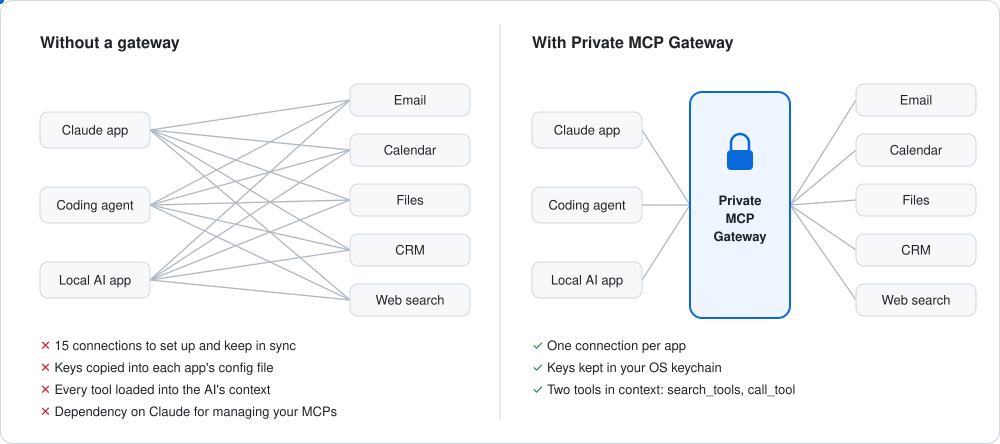

<p align="center">
  
</p>

<h1 align="center">Private MCP Gateway</h1>

<p align="center">
  <strong>Too many MCPs hey?</strong><br>
  A privacy-first MCP gateway that runs on your own machine.
</p>

<p align="center">
  <a href="#licence"></a>
  <a href="https://modelcontextprotocol.io"></a>
  <a href="docs/install.md"></a>
  <a href="docs/install.md#docker"></a>
  <br>
  <a href="docs/privacy.md"></a>
  <a href="docs/privacy.md"></a>
  <a href="docs/design.md"></a>
  <a href="docs/design.md"></a>
  <a href="#contributing"></a>
</p>

<!-- Enable once the repo is public and the first release, npm package and image exist:
  <a href="https://github.com/baobab-tech/pMCPg/releases/latest"></a>
  <a href="https://www.npmjs.com/package/private-mcp-gateway"></a>
  <a href="https://github.com/baobab-tech/pMCPg/pkgs/container/pmcpg"></a>
  <a href="https://github.com/baobab-tech/pMCPg/stargazers"></a>
-->

<p align="center">
  <a href="#get-started"><b>Get started</b></a> ·
  <a href="docs/how-it-works.md">How it works</a> ·
  <a href="docs/privacy.md">Privacy</a> ·
  <a href="docs/catalog.md">Catalog</a> ·
  <a href="#documentation">Docs</a>
</p>

Connect your AI app once. The gateway runs your MCP servers, keeps your keys safe, and hides personal data and keys from cloud AI models or providers.

<p align="center">
  <picture>
    <source media="(prefers-color-scheme: dark)" srcset="docs/assets/before-after-dark.svg">
    
  </picture>
</p>

## What it is

- **One connection.** Your AI app connects to the gateway. The gateway connects to your MCP servers, local or remote.
- **Tools on demand.** The AI sees two tools, `search_tools` and `call_tool`, instead of hundreds.
- **Keys in your keychain.** The gateway signs in for you and refreshes tokens. The AI never sees a key.
- **Private by design.** It runs on your computer. No account, no cloud service, no tracking.
- **Personal data masking (Beta).** For cloud AI models, `jane@acme.org` becomes `[EMAIL_1]` before the model sees it. It catches common patterns and can miss things, so don't rely on it alone for sensitive data.

<p align="center">
  <picture>
    <source media="(prefers-color-scheme: dark)" srcset="docs/assets/where-data-goes-dark.svg">
    
  </picture>
</p>

With a local model and local servers, nothing leaves your machine. [More on privacy →](docs/privacy.md)

<p align="center">
  <picture>
    <source media="(prefers-color-scheme: dark)" srcset="docs/assets/connectors-swipe-dark.svg">
    
  </picture>
</p>

## Get started

1. **Install.** On macOS or Linux, paste this into a terminal:

   ```bash
   curl -fsSL https://github.com/baobab-tech/pMCPg/releases/latest/download/install.sh | sh
   ```

   On Windows, paste this into PowerShell:

   ```powershell
   irm https://github.com/baobab-tech/pMCPg/releases/latest/download/install.ps1 | iex
   ```

   The script checks the download, sets the gateway to start at login and opens the web UI. Other options and uninstall: [Install](docs/install.md).
2. **Add servers.** Import them from your AI apps, or paste a command or URL. A searchable [catalog](docs/catalog.md) with presets is coming soon.
3. **Sign in** to each account.
4. **Connect your AI app** with the snippet on the "Connect a client" page.

Developers:

```bash
npx private-mcp-gateway                              # or: brew install baobab-tech/tap/pmcpg
claude mcp add briefing -- pmcpg connect briefing      # connect Claude Code to the "briefing" profile
```

Docker: `ghcr.io/baobab-tech/pmcpg:slim` or `:full`. See [Install](docs/install.md).

## For social impact organizations

Anyone can use Private MCP Gateway. Baobab Tech builds it with a focus on nonprofits, NGOs, foundations and development agencies. The [catalog](docs/catalog.md#social-impact-organizations-collection), coming soon, will have presets for fundraising, grants research, M&E and reporting, communications and program data, with strict privacy defaults.

## Documentation

| | |
|---|---|
| [How it works](docs/how-it-works.md) | Request flow, profiles, search, architecture |
| [Install](docs/install.md) | One-line install, npm, Homebrew, Docker, manual download, uninstall |
| [Connect your AI app](docs/connect-clients.md) | Claude Code, Claude Desktop, other clients |
| [Configuration](docs/configuration.md) | CLI, `config.yaml`, vault, remote servers and OAuth |
| [Privacy](docs/privacy.md) | What leaves your machine, masking, data-flow rules, approvals, activity log |
| [Security](docs/security.md) | Web UI security, process isolation, threat model |
| [Catalog](docs/catalog.md) | Server entries and presets (coming soon) |
| [Concept](docs/concept.md) and [Design](docs/design.md) | Why it exists and how it is built |

## Contributing

Issues and pull requests are welcome. New runtime dependencies need a written reason in the pull request. Diagrams are generated by `python3 docs/assets/src/build_svgs.py`.

## Licence

[Apache 2.0](LICENSE)
