# Connect your AI app

Each profile has its own URL. The web UI's "Connect a client" page gives a copy-ready snippet for each app.

<p align="center">
  <picture>
    <source media="(prefers-color-scheme: dark)" srcset="assets/connectors-swipe-dark.svg">
    
  </picture>
</p>

## The stdio bridge

`pmcpg connect <profile>` serves MCP on stdio and relays it to the profile's HTTP endpoint. It reads the profile's client token from pMCPg, so the app's settings hold a command and no token. Use it for every app that can run a command.

`pmcpg connect-app <app>` and the web UI's Connect buttons write the bridge for Claude Code, Claude Desktop, Cursor, VS Code and LM Studio. They use the absolute path of the running `pmcpg`, because apps started from the Dock or Start menu often have a short `PATH`. In development (`bun src/cli/main.ts`) they write `bun` plus the absolute path of `main.ts`.

If an app cannot find `pmcpg` from a snippet you pasted by hand, replace `pmcpg` with its full path (`which pmcpg`).

## Claude Code

```bash
claude mcp add --scope user briefing -- pmcpg connect briefing
```

## Claude Desktop, Cursor, LM Studio

Add to `claude_desktop_config.json`, `~/.cursor/mcp.json` or `~/.lmstudio/mcp.json`:

```json
{
  "mcpServers": {
    "briefing": { "command": "pmcpg", "args": ["connect", "briefing"] },
    "research": { "command": "pmcpg", "args": ["connect", "research"] }
  }
}
```

## VS Code

Add to your user `mcp.json` or `.vscode/mcp.json`:

```json
{
  "servers": {
    "briefing": { "type": "stdio", "command": "pmcpg", "args": ["connect", "briefing"] }
  }
}
```

## HTTP with a token (fallback)

For apps that cannot run a command. The app's settings then hold the profile token in plain text: anyone who reads that file can use every tool in the profile. VS Code may also upload its user `mcp.json` with Settings Sync.

- URL: `http://127.0.0.1:7431/p/<profile>/mcp`
- Header: `Authorization: Bearer <token>`, from the web UI's "Connect a client" page

`pmcpg connect-app <cursor|vscode|lm-studio> --http` writes this form. Claude Code and Claude Desktop always get the bridge.

## Replacing a token

`pmcpg token rotate --profile <name>`, or "New token" on the Connect panel, replaces a profile's token. The old one stops working at once.

- Apps on the stdio bridge read the new token on their next request.
- Cursor, VS Code and LM Studio files that hold the old token get the new one; each file is backed up first.
- Anything else you gave the token to needs the new one: `pmcpg profile token <name>`.

`pmcpg token rotate --admin` replaces the admin token the `pmcpg` command uses to reach the running gateway. Nothing needs reconnecting.

---

[← Back to README](../README.md)
