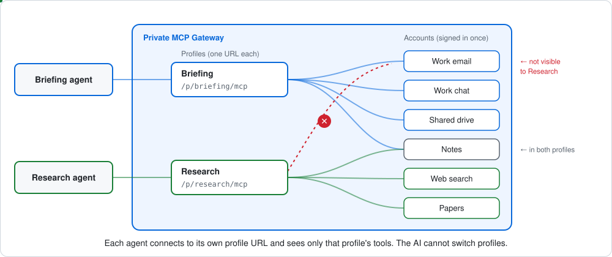
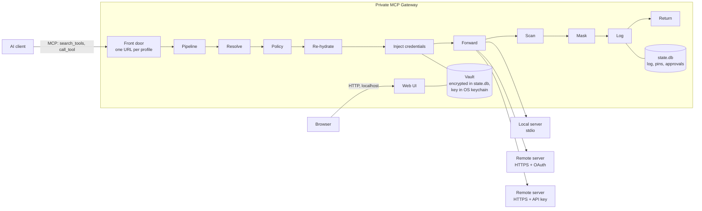

# How it works

The AI sees two tools, `search_tools` and `call_tool`. Every call passes through the gateway, which checks policy, adds credentials, and filters the result.

## How a request flows

  <picture>
    <source media="(prefers-color-scheme: dark)" srcset="assets/request-flow-dark.svg">
    
  </picture>

1. The AI searches for a tool. The gateway returns only the matches.
2. The AI calls the tool. The gateway checks your rules and adds the saved sign-in. The AI never sees your keys.
3. The result comes back. For a cloud model, `jane@acme.org` becomes `[EMAIL_1]` before it reaches the AI.
4. The AI replies to `[EMAIL_1]`. The gateway puts `jane@acme.org` back before the call reaches the email server.

Real placeholders also carry a short tag, for example `[EMAIL_1_k7qx]`. The tag changes on every gateway run, so an old placeholder never restores a different person's value.

## Profiles

  <picture>
    <source media="(prefers-color-scheme: dark)" srcset="assets/profiles-dark.svg">
    
  </picture>

- A profile is a set of accounts for one purpose.
- Each profile has its own address. Point each AI agent at the profile it needs.
- An agent sees only its profile's tools. The AI cannot switch profiles.
- One account can sit in several profiles. You sign in once.
- A default **All** profile holds every account, for people who want one connection for everything.

## Profile URLs

Each profile has its own endpoint and its own client token.

| Endpoint | Profile |
|---|---|
| `http://127.0.0.1:7431/p/briefing/mcp` | Briefing |
| `http://127.0.0.1:7431/p/research/mcp` | Research |
| `http://127.0.0.1:7431/mcp` | All (every account) |

- Isolation comes from the connection. A client on `/p/research/mcp` cannot see or call Briefing's tools, whatever the model asks.
- When a profile holds two accounts of one server, tools are named `server@account__tool`, for example `gmail@work__search`.
- Each stdio server runs once per account. Profiles that share an account share the process.

## Search

- `search_tools` takes a `query` and a `limit` (default 5, max 10) and returns matching tools with full input schemas and annotations.
- Ranking is BM25 over tool names, titles, descriptions and parameter names.
- Tool lists are cached, so search works while a stdio server is stopped. Stdio servers start on first use and stop after 10 idle minutes.
- Tools of accounts that need sign-in, quarantined tools and tools blocked by policy never appear in results.

## Architecture

Design details: [Concept](concept.md) (what and why, threat model) and [Design](design.md) (stack, data model, process model).

---

[← Back to README](../README.md)
