# Privacy

> **Beta in v0.1.** Personal data masking (Off, Standard, Strict) and placeholder put-back are experimental. Masking catches common patterns like emails and phone numbers. It can miss things, so don't rely on it alone for sensitive data.

What leaves your machine depends on where your AI model and MCP servers run. The gateway controls the lines that cross into the cloud.

<p align="center">
  <picture>
    <source media="(prefers-color-scheme: dark)" srcset="assets/where-data-goes-dark.svg">
    
  </picture>
</p>

## What stays private

- The gateway, your server list, your keys and your log stay on your machine.
- The gateway connects only to:
  - the MCP servers you added
  - their sign-in services, to sign in and refresh tokens
  - the public catalog, only while you browse it
- No telemetry, no update ping, no crash reports.
- Baobab Tech never holds your data, credentials or usage.

Your AI model and your MCP servers decide what else leaves the machine:

| AI model | MCP servers | What leaves your machine | Suggested setup |
|---|---|---|---|
| Local | Local | Nothing | Masking `off` |
| Local | Some remote | What the AI sends to those servers | Masking `off`. Data-flow rules and approvals on tools that send data out |
| Cloud | Local | Every tool result the AI reads, inside the prompt | Masking `standard` or `strict` |
| Cloud | Some remote | Tool results to the model provider, and what the AI sends to remote servers | Masking `standard` or `strict`, plus data-flow rules and approvals |

Remote MCP servers see real values: the gateway puts them back before forwarding a call, because the server needs them to do its job. Data-flow rules and approvals decide which data may go to which server.

**Masking has limits.** Pattern matching catches emails, phone numbers, card numbers and ID formats well. Names in free text are harder: some get missed, and some ordinary words get masked. Masking lowers what the AI provider sees. It does not guarantee anonymity.

## Privacy levels

Set per profile. Pick the level by where the model runs: `off` for a profile used only by a local model, `standard` or `strict` for a profile used by a cloud model. Point a local model and a cloud model at different profiles to get both.

| Level | Masks |
|---|---|
| `off` | Nothing |
| `standard` | Emails, phone numbers, card numbers (Luhn-checked), IBANs, IP addresses, national ID formats |
| `strict` | `standard` plus names, organizations and addresses where a label or layout marks them (`Name:`, `Jane Doe <jane@...>`, `Dr. ...`, street patterns, postcodes). Names in running text need the optional local model |

- Placeholders use the form `[TYPE_n_tag]`, for example `[EMAIL_1_k7qx]`, and stay stable within a session: the same email always maps to the same placeholder. The tag changes on every gateway run, so a placeholder from before a restart never restores someone else's value; the call is stopped and the AI is told to read the source again.
- The mapping lives in memory for the session. It is written to disk only if you turn that on.
- A session is one app connected through `pmcpg connect`. Apps that connect over HTTP share one session per profile. A session unused for 8 hours starts over, with new placeholders and no data-flow history.
- A session keeps up to 10,000 placeholders. Past that, the least recently used one is dropped; a call that still uses it is stopped like one from before a restart.
- "Forget masked values" drops the placeholder map of one profile (Profiles, eraser button) or of every profile (Settings). From the terminal: `pmcpg privacy reset [--profile <name>]`, which asks the running gateway. New sessions get a tag no dropped session used, so an old placeholder is stopped like one from before a restart. The activity log records the reset with counts only.
- `call_tool` arguments are scanned for placeholders and restored before forwarding.
- A value goes back only to the account whose results contained it. A call that puts `[EMAIL_1_k7qx]` from your mail into a different account's tool is blocked, so a malicious tool cannot collect real values by asking for placeholders. Allow a specific account with `shareAcrossAccounts`.
- Exceptions can be set per server or per field.
- Free-text name and address detection will use an optional local model, picked by a hardware probe (CPU, Apple Neural Engine, DirectML, CUDA) and run in a separate worker process. Nothing leaves the machine.
- Every text field of a result is masked: text, link names, URIs, titles and descriptions, `_meta`, and keys in structured content (a map keyed by email). Image, audio and blob data pass through unchanged; the UI says so.
- Preview masking on a sample result in the web UI before you rely on a level.
- Try a level from the terminal: `pmcpg privacy check --level strict @sample.txt`. `pmcpg privacy explain` lists every pattern.

Fine-tune per profile under `privacyOptions`:

```yaml
profiles:
  work:
    privacy: standard
    privacyOptions:
      allow: [me@myngo.org]          # never masked
      skipAccounts: [calendar@work]  # results from this account are not masked (secrets still are)
      skipTypes: [IP]                # types never masked
      skipFields: [ticket_id]        # keys in structured results left as they are
      shareAcrossAccounts: [calendar] # accounts that may receive values masked from other accounts ("*" = all)
      secretsInArguments: block      # block | redact | off
      secretsInResults: redact       # redact | off
```

Secrets (API keys, tokens, private keys, passwords, credentials in URLs) are redacted as `[SECRET_REDACTED]` at every level, including `off`, and never restored. A tool call whose arguments contain a secret is blocked by default. Detection uses the gitleaks rule set (MIT).

## Trust levels and data-flow rules

Each server gets a trust level:

| Level | Meaning |
|---|---|
| `local` | Runs on your machine, handles your own data |
| `private-data` | Reads private data (email, CRM, files) |
| `external-content` | Returns content written by others (web pages, inbound email), which may carry injected instructions |
| `can-send` | Can send data out (email, posts, webhooks) |

A server with no trust level is treated as unknown: its results count as private data and outside content, and its tools count as able to send data out, except tools the server marks read-only. Label servers to make this more precise.

Rules are written against these levels. The default rule: after a session reads from an `external-content` server, calls to `can-send` tools need approval for the rest of that session. This breaks the "private data + untrusted content + a way out" combination that prompt-injection attacks rely on.

Cross-profile flows cannot happen: a client on one profile cannot reach another profile's tools.

## Approvals

- Set by tool, by server, or by MCP annotations (`readOnlyHint`, `destructiveHint`).
- Triggered by data-flow rules.
- Answered in the web UI's Approvals page, with an optional browser notification, or through MCP elicitation where the client supports it, with a CLI prompt as fallback.
- `read_only: true` on a profile blocks every tool not marked read-only.

## Tool pinning and quarantine

- When a server is added, the gateway stores a hash of each tool's name, title, description, schema and annotations (`readOnlyHint`, `destructiveHint`). A server that relabels a tool as read-only after approval gets it quarantined.
- If a server later changes a tool, that tool is quarantined: hidden from search until you review the diff in the web UI and approve it.
- Tool lists are re-checked on reconnect and on `tools/list_changed`.

## Secret scanning

- Rules from gitleaks, compiled into the binary.
- Applied to tool results and to outgoing arguments.
- Matches are redacted with no re-hydration.

## Activity log

- Records each search and call: time, profile, tool, policy decisions, what was masked, duration.
- Argument and result values are excluded by default.
- Encrypted at rest, with a retention period you set (default 30 days).
- Browse and filter in the web UI. Export as JSON lines.

---

[← Back to README](../README.md)
